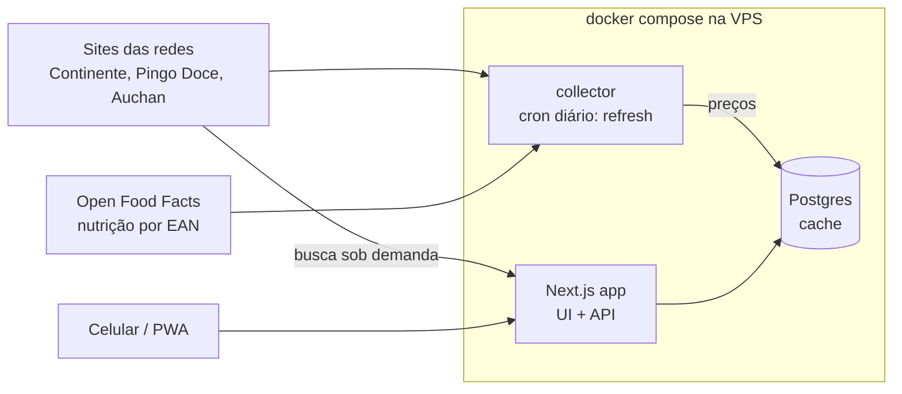

# Arquitetura

## Visão geral
Uma única aplicação Next.js (UI PWA + API em route handlers) e um Postgres, ambos no `docker compose` de uma VPS. Os preços vêm **sob demanda**: a busca do usuário consulta os sites das redes, e o resultado fica em cache no banco por 24 h. Um job **collector** diário (cron na VPS) só atualiza os produtos em uso ([ADR 0003](decisions/0003-on-demand-prices.md)). O Smart Split é calculado em código puro, sem IA. A IA só entra em fases futuras (OCR), atrás de cache.

## Componentes
| Componente | Responsabilidade | Onde no código |
|---|---|---|
| Smart Split | Melhor combinação de 1..N redes para a lista (força bruta, exata) | `src/features/smart-split/` |
| Equivalência | "Aceito parecido": V0 por nome-base sem marca + mesmos atributos (sabor, dieta, gordura) + tamanho ±10% + menor €/L·kg; nutrição (Open Food Facts) em spec futura | `src/features/equivalence/` |
| Lista / preços / lojas | Telas e casos de uso de cada feature | `src/features/<feature>/` |
| API + UI | Páginas, route handlers, `/api/health`, manifest PWA | `src/app/` |
| Catálogo | Parsers por rede (puros), fetch, cache de busca | `src/features/catalog/` |
| Correspondência | Mesmo produto entre redes: EAN → regra → confirmação | `src/features/matching/` |
| Collector | Job diário que atualiza os preços dos produtos em uso | `src/collector/` |
| Banco | Schema Drizzle e migrations | `src/shared/db/`, `drizzle/` |
| Config | Única leitura de env vars | `src/shared/config.ts` |

## Fluxo de dados
1. O usuário busca um termo; a app usa o cache (< 24 h) ou consulta as 3 redes e grava os produtos encontrados.
2. Ao adicionar um item, a app liga o mesmo produto nas outras redes (EAN; no Pingo Doce, por regra ou confirmação).
3. A lista (guardada no aparelho) vai para a API, que monta a tabela `item × rede` (no futuro, só com redes que têm loja no raio).
4. `smartSplit()` devolve o melhor plano por número de paradas e o melhor plano geral.
5. A UI mostra o total, a poupança e onde comprar cada item, com link e data do preço.
6. Diariamente, `docker compose run --rm collector` atualiza os produtos usados nos últimos 30 dias.

## Fronteiras e riscos
- **Sites das redes (externo, frágil):** mudam sem aviso e podem bloquear o scraping. Cada rede fica isolada no seu módulo, e a falha de uma não para as outras. Antes de abrir ao público, rever os termos de uso, ver [fontes](references/pt-supermarket-sources.md).
- **Preço por rede ≠ preço da loja:** premissa a validar, ver [product](product.md).
- **Banco em produção:** o `deploy.sh` faz backup antes das migrations. O rollback volta a imagem, não o schema.

Decisões que explicam esta arquitetura: ver [decisions/](decisions/).
